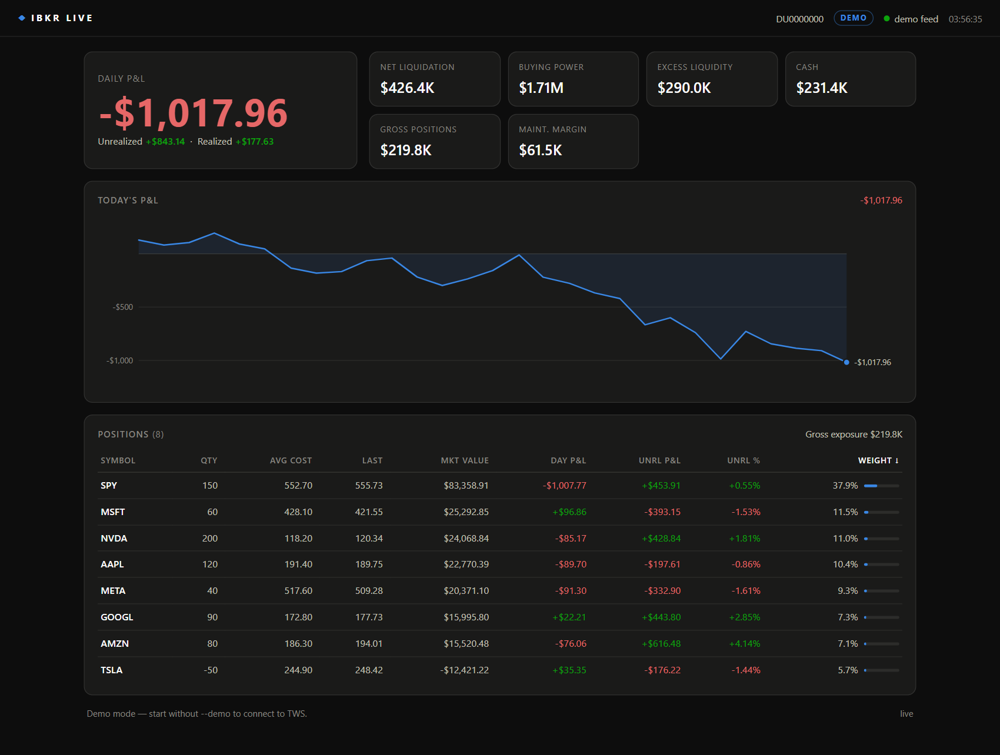
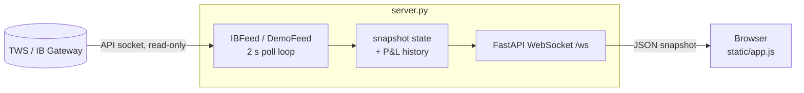

# IBKR Live Dashboard

[](https://github.com/omarpatel/ibkr-live-dashboard/actions/workflows/ci.yml)
[](LICENSE)


A read-only, real-time browser dashboard for an Interactive Brokers account: daily P&L, positions and account values streamed from TWS or IB Gateway over a WebSocket.



## Overview

A small FastAPI server connects to the TWS API socket on localhost with `readonly=True`, so it cannot place, modify or cancel orders. Every two seconds it collects the account summary, account-level P&L, the portfolio and per-position daily P&L, then pushes one JSON snapshot to every connected browser. The front end is a single page of plain HTML, CSS and JavaScript with no build step and no third-party libraries; the P&L chart is drawn as inline SVG.

## Features

- **Live account view**: daily, unrealized and realized P&L plus net liquidation, buying power, excess liquidity, cash, gross position value and maintenance margin.
- **Intraday P&L chart**: built from samples collected while the server runs, with axis ticks and a hover tooltip. The line resets after a gap of more than four hours.
- **Positions table**: quantity, average cost, last price, market value, day P&L, unrealized P&L and %, and portfolio weight. Click a header to sort.
- **Read-only by design**: connects with the read-only API flag; the dashboard never sends orders.
- **Zero-config connection**: tries TWS live (7496), TWS paper (7497), IB Gateway live (4001) and IB Gateway paper (4002) in order, and shows a LIVE / PAPER badge for the account it found.
- **Self-healing**: the server reconnects when TWS restarts, and the page reconnects its WebSocket automatically and shows how long ago the last update arrived.
- **Demo mode**: `--demo` streams a random-walk portfolio so the UI can be previewed without a broker connection.
- **No market-data subscription required**: prices and valuations come from IBKR's own portfolio updates.

## Architecture



`Feed` holds the shared snapshot and broadcasts it to every client. `IBFeed` fills it from `ib_async` (account summary, `reqPnL`, `reqPnLSingle` subscriptions kept in sync with the portfolio). `DemoFeed` fills it with simulated data. Values IBKR reports as NaN are converted to `null` before they are sent.

## Tech stack

- Python 3, FastAPI, Uvicorn, [ib_async](https://github.com/ib-api-reloaded/ib_async)
- Vanilla JavaScript, HTML and CSS (inline SVG chart)
- pytest and Ruff, run in GitHub Actions

## Getting started

### 1. Install

```bash
python -m venv .venv
# Windows: .venv\Scripts\activate    macOS/Linux: source .venv/bin/activate
pip install -r requirements.txt
```

### 2. Try it without a broker

```bash
python server.py --demo
```

Open http://127.0.0.1:8399.

### 3. Connect to your account

In TWS, open **File > Global Configuration > API > Settings** and:

1. Check **Enable ActiveX and Socket Clients**.
2. Check **Read-Only API** (recommended; the dashboard only reads).
3. Use socket port **7496** (live) or **7497** (paper). Both are tried automatically, as are IB Gateway ports 4001/4002.
4. Leave **Allow connections from localhost only** checked.

Then run:

```bash
python server.py            # connect to TWS / IB Gateway
python server.py --port 9000  # serve the page on a different port (default 8399)
```

The page shows a setup hint until the connection succeeds and connects on its own once TWS is ready.

## Development

```bash
pip install -r requirements-dev.txt
ruff check .
pytest
```

The tests cover NaN handling, demo-feed accounting (net liquidation equals cash plus position value), P&L history sampling, and the HTTP and WebSocket endpoints via FastAPI's test client.

## Project structure

```
server.py              FastAPI app, IBFeed (TWS) and DemoFeed data sources
static/index.html      page layout
static/app.js          WebSocket client, rendering, SVG chart, sortable table
static/style.css       dark theme
tests/test_server.py   unit and endpoint tests
docs/screenshot.png    demo-mode screenshot
```

## License

MIT. See [LICENSE](LICENSE).
